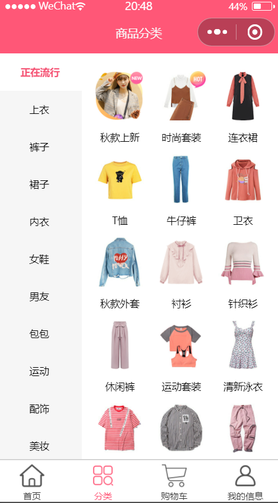
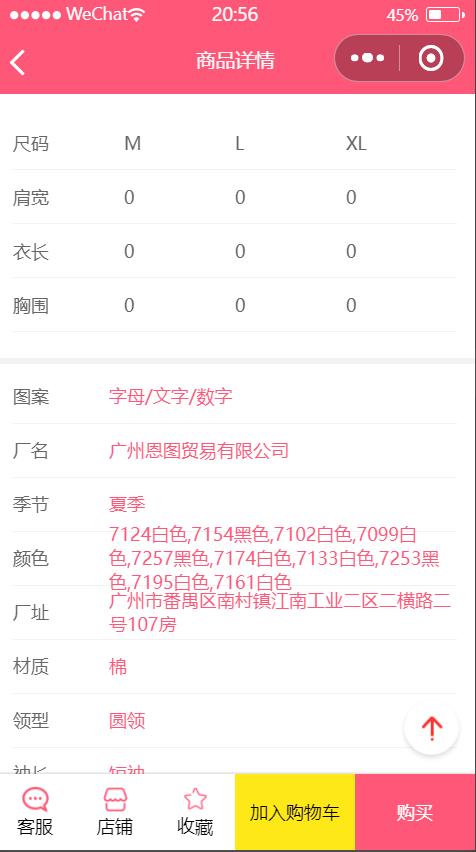
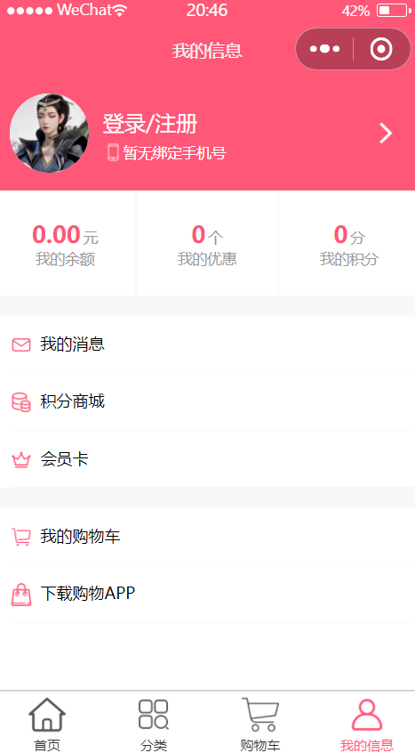

## `MinMall`

> 本节基于仓库内实际源码逐文件整理（非课程讲义），说明该项目**用了什么框架/技术/工具**、**实现了什么功能**、**还存在哪些问题**。
>
> 说明：结论来自源码阅读，**未在微信开发者工具里运行验证**（本项目没有 CLI，无法像 Web 项目那样跑构建）。涉及"实际会不会滚动""会不会告警"的判断都标了推理依据。

## 一、项目概览

`MiniMall` 是一个**微信小程序原生框架**写的电商仿写项目（仿"购物街"），**没有任何第三方依赖**：没有 npm 包、没有 UI 组件库、没有状态管理库，请求封装、轮播、Tab 吸顶、返回顶部、购物车状态全部手写。它的重点是演示小程序的原生能力：自定义组件 + `triggerEvent`、`scroll-view` 滚动体系、`App()` 全局数据、`rpx` 适配。

## 二、技术栈总览

| 分类      | 技术 / 工具                    | 版本 / 说明                                                           |
| --------- | ------------------------------ | --------------------------------------------------------------------- |
| 应用框架  | 微信小程序原生框架             | WXML + WXSS + JS + JSON，`compileType: miniprogram`                   |
| 基础库    | libVersion                     | `2.23.2`（`project.config.json`）                                     |
| 语言      | JavaScript（ES6 模块）         | `import` / `export`，靠开发者工具 `es6: true` 转译，**无 TypeScript** |
| 依赖管理  | **无**                         | 没有 `package.json`、没有 `miniprogram_npm`，`nodeModules: false`     |
| UI 组件库 | **无**                         | 没用 vant / weui，5 个通用组件 + 13 个页面私有组件全手写              |
| 状态管理  | `App()` 的 `globalData` + 回调 | 见 4.2，没有用 mobx-miniprogram 之类的库                              |
| 网络      | `wx.request` + Promise 封装    | `services/network.js`，超时 10s                                       |
| 布局适配  | `rpx` 为主 + 运行时换算        | 20 个 wxss 用到 rpx（共 181 处），另有 14 处 px                       |
| 图标/图片 | 本地 `assets/images`           | 按 tabbar / common / detail / profile / home 分目录                   |
| 代码规范  | **无**                         | 没有 ESLint / Prettier 配置                                           |
| 测试      | **无**                         | 没有单测，也没有 `app.json` 里的自动化                                |
| 开发工具  | 微信开发者工具                 | 唯一运行/调试入口；`urlCheck: false`、`compileHotReLoad: true`        |

## 三、工程结构与分层

| 目录                 | 职责                                                                              | 说明                                                  |
| -------------------- | --------------------------------------------------------------------------------- | ----------------------------------------------------- |
| `app.js`             | 全局入口：屏幕信息换算 + 购物车"伪 store"                                         | 见 4.2，是整个项目最"重"的文件                        |
| `app.json`           | 6 个页面 + 4 个 tabBar + 窗口样式                                                 | `"debug": true` 仍开着                                |
| `pages/`             | 6 个页面：`home` / `category` / `cart` / `detail` / `profile` / `webview`         | 只有前 4 个在 tabBar 里                               |
| `pages/*/component/` | 页面私有组件（home 2 个、category 2 个、detail 6 个、profile 3 个）               | 命名风格不统一（`component/` vs `component/Header/`） |
| `components/`        | 5 个通用组件：`back-top`、`good-item`、`good-list`、`swiper-image`、`tab-control` | 被多个页面复用                                        |
| `services/`          | 请求层：`config` / `network` / `home` / `category` / `detail` / `index`           | 按业务域拆分 + 聚合导出                               |
| `common/const.js`    | 常量：`POP` / `NEW` / `SELL` / `TOP_DISTANCE`                                     |                                                       |
| `utils/utils.js`     | 时间格式化 `dateFormate`                                                          | **死代码**，且用的是 WXS API（见第七节第 8 条）       |
| `assets/images/`     | 本地图片                                                                          | 27 个文件，按用途分目录                               |

## 四、核心技术实现

### 4.1 请求层：Promise 化 `wx.request`

`services/network.js` 只有一个函数：

```js
wx.showLoading({ title: '加载中...' })  →  wx.request({ url, timeout, data })
  →  success: resolve(res.data)
  →  fail: reject
  →  complete: wx.hideLoading()
```

业务层再按域拆成 `home.js`（banner、商品列表）、`category.js`（分类、子分类、子分类详情）、`detail.js`（详情、推荐），`services/index.js` 用 `import * as` 聚合后按模块导出，页面里 `homeService.getBannerData()` 这样调用。

### 4.2 全局状态：`App()` 上手写的"伪 store"

没有引入任何状态库，购物车状态直接挂在 `App()` 实例上：

| 部分     | 做法                                                                                                                                                                                                  |
| -------- | ----------------------------------------------------------------------------------------------------------------------------------------------------------------------------------------------------- |
| 数据     | `globalData.cartList`（数组，元素是 `{iid, imageUrl, title, desc, price, counter, checked}`）                                                                                                         |
| 写操作   | `app.addToCart(item)`（同 `iid` 则 `counter+1`，否则 `counter=1` 后 push）、`app.moveCartShop(iid)`（`counter-1`）、`app.isSelectAllChangeHandle(bool)`、`app.singleCartShopIsSelect(iid)`            |
| 通知机制 | 每个写操作末尾调 `_cartShopCalculateCallBack()`，它执行 `this.cartCallBack()`；而 `cartCallBack` 是**购物车页在 `onLoad` 里赋值的单槽回调**（`app.cartCallBack = () => { 本页 setData + 重算总价 }`） |

也就是说：**数据在 App，视图在页面，两者靠一个函数槽手动连线**。这是"能用但脆"的典型写法，问题见第七节第 1 条。

### 4.3 详情页数据建模：三个 class

`services/detail.js` 里除了两个接口，还导出了三个"数据规整类"，把接口返回的深层结构摊平成视图直接可用的形状：

| 类                                           | 作用                                                                                                |
| -------------------------------------------- | --------------------------------------------------------------------------------------------------- |
| `GoodsBaseInfo(itemInfo, columns, services)` | 标题、描述、现价/原价/折扣、销量列、服务承诺（`services.filter(v => !!v.icon)` 过滤掉没有图标的项） |
| `ShopInfo(shopInfo)`                         | 店铺 logo/名称/粉丝/销量/评分/商品数                                                                |
| `ParamInfo(info, rule)`                      | 参数图片、规格键值对、尺码表（二维数组）                                                            |

这是这个项目里比较值得学的一点：**在数据入口处把字段收敛成固定形状**，组件里就不用再层层判空。

### 4.4 组件通信：两条方向不同的通路

| 方向    | 手段                                                          | 例子                                                                                                           |
| ------- | ------------------------------------------------------------- | -------------------------------------------------------------------------------------------------------------- |
| 子 → 父 | `this.triggerEvent('xxx', detail)`                            | `tab-control` 抛 `tabclick`、`bottom-bar` 抛 `addcart`、`recommend` 抛 `imageLoad`、`left-menu` 抛 `menuClick` |
| 父 → 子 | `this.selectComponent('.tab-control').setCurrentIndex(index)` | 首页 Tab 吸顶后，两份 `tab-control` 实例（吸顶层 + 内联层）需要同步高亮，用组件方法直接改子组件 `data`         |

### 4.5 滚动体系：`scroll-view` + `createSelectorQuery`

- 页面用 `<scroll-view style="height:{{ScreenTotalH}}rpx" bindscroll bindscrolltolower>` 控制滚动，而不是用页面级滚动（注释里写明"官方文档不推荐频繁调用 `this.setData`，采用 scroll-view 内置组件"）；
- **返回顶部**：`bindscroll` 里比较 `scrollTop > TOP_DISTANCE(1000)` 决定是否显示 `back-top`；
- **Tab 吸顶**：每帧用 `createSelectorQuery().select('.tab-control').boundingClientRect()` 拿 `rect.top`，`top <= 0` 时显示另一份 `position: fixed` 的 `tab-control`（`showTabControl`）；
- **上拉加载**：`bindscrolltolower` → `_getTabSwitchData(currentType)`。

### 4.6 屏幕适配：rpx 为主 + 运行时换算

`app.js` 开头拿 `wx.getSystemInfoSync()`，用 `750 / windowWidth` 把 px 换算成 rpx，算出状态栏高度、导航栏高度、tabBar 高度、窗口宽高，放进 `globalData.screenInfo`，页面拿去当 `scroll-view` 的 `style="height:{{ScreenTotalH}}rpx"`。这样 `scroll-view` 能撑满"窗口高度"（不含 tabBar），避免页面整体被 tabBar 顶出屏幕。

## 五、功能清单

| 页面     | 路由                      | 已实现功能                                                                                                                                                                |
| -------- | ------------------------- | ------------------------------------------------------------------------------------------------------------------------------------------------------------------------- |
| 首页     | `pages/home/home`         | 轮播图（`swiper-image`，自动播放 + 点击跳 webview）、四个推荐入口、本周流行、Tab 切换（流行/新款/精选，三份分页数据）、商品瀑布列表、上拉加载更多、Tab 吸顶、返回顶部按钮 |
| 分类     | `pages/category/category` | 左侧一级分类菜单（`scroll-view` 独立滚动 + active 高亮）、右侧子分类图标网格 + 该分类商品列表、点击左侧切换右侧内容                                                       |
| 购物车   | `pages/cart/cart`         | 商品列表、单选、全选、数量加减（减到 1 有提示）、合计金额（只算选中项）、结算件数、空态文案                                                                               |
| 商品详情 | `pages/detail/detail`     | 顶部轮播、基础信息（价格/销量列/服务）、店铺信息（销量/粉丝/评分高低）、图文详情、规格参数表（嵌套表格）、用户评论、加入购物车（并 Toast）、返回顶部                      |
| 我的     | `pages/profile/profile`   | 头部（头像 + 登录/注册入口 + 未绑定手机号）、资产三栏（余额/优惠/积分，静态 0）、两组列表项（我的消息/积分商城/会员卡 + 我的购物车/下载 APP，静态）                       |
| 外链页   | `pages/webview/webview`   | 用 `<web-view>` 承载 banner / 推荐位点击后的 H5 链接                                                                                                                      |

**未完成的部分**：详情页"商品推荐"写死 `待开发~`（`good-list` 被注释掉），但 `/recommend` 接口其实已经请求了。

## 六、工具链与工程配置

| 配置 / 工具                   | 作用                                                                                                                 |
| ----------------------------- | -------------------------------------------------------------------------------------------------------------------- |
| 微信开发者工具                | 唯一编译/预览/调试入口，无 CLI、无 CI                                                                                |
| `project.config.json`         | `urlCheck: false`（配合 http 接口）、`es6/postcss/minified/enhance` 全开、`nodeModules: false`、`libVersion: 2.23.2` |
| `project.private.config.json` | 只覆盖了 `compileHotReLoad: true`                                                                                    |
| `app.json`                    | 6 页面 4 tabBar；`"debug": true`                                                                                     |
| `sitemap.json`                | 全量 allow                                                                                                           |
| ESLint / Prettier             | **无**                                                                                                               |
| 测试                          | **无**                                                                                                               |
| `.gitignore`                  | **无**（`project.private.config.json` 这类本地文件没有隔离）                                                         |
| Git 历史                      | 只有 `Initial commit` 和 `feat(views):项目迁移` 两个提交                                                             |

## 七、问题修复记录

> 已按优先级处理：先修 5 个高危（购物车持久化、返回顶部、滚动性能、Loading 并发、调试开关），再修中危的标签/属性/格式化/死代码，最后补 `.gitignore`。
>
> **一条重要修正**：上一版建议"返回顶部改成 `wx.pageScrollTo`"是错的 —— 这两页的滚动发生在 `<scroll-view>` 内部，页面本身并不滚动，`wx.pageScrollTo` 动的是页面，对它们无效。正确做法是制造一次 `scroll-top` 的真实变化（见下表第 2 条）。

**验证方式**（本项目无 CLI，只能做静态校验）：

- 12 个改动过的 `.js` 全部通过 `node --check`（以 ESM 解析）；
- 24 个 `.wxml` 全部通过标签配对校验；
- 28 个 `.json` 全部可被 `JSON.parse` 解析。

仍未在微信开发者工具里运行，交互类改动（返回顶部、Tab 吸顶、购物车订阅）建议真机/模拟器过一遍。

| 级别 | 原问题 | 处理方式 | 涉及文件 |
| --- | --- | --- | --- |
| 高 | 购物车不持久化 + 单槽回调 | `onLaunch` 从 `cartGoods` 读回；每次变更在 `_cartShopCalculateCallBack()` 里 `setStorageSync` 落盘；`app.cartCallBack` 换成 `cartListeners` 数组 + `onCartChange` / `offCartChange`，购物车页 `onLoad` 订阅、`onUnload` 退订 | `app.js`、`pages/cart/cart.js` |
| 高 | 返回顶部不生效 | 改成"两步赋值"：先 `topPosition = 当前 scrollTop`（用 `this._scrollTop` 记录，不 setData），`wx.nextTick` 里再归 0，让 `scroll-top` 真正发生变化；首页同时复位 `showBackTop` / `showTabControl` | `pages/home/home.js`、`pages/detail/detail.js` |
| 高 | `bindscroll` 每帧做节点查询 | 吸顶阈值只在图片 `load` 和 `onReady` 时测（测量值 = `rect.top + 当前 scrollTop`，滚动中测也准确），滚动回调只做算术比较，且值没变就不 `setData`；另加"首次滚动补测"兜底 | `pages/home/home.js` |
| 高 | Loading 遮罩并发下会闪 | 引用计数 + `mask: true`；失败时统一 `wx.showToast` 提示后再 `reject` | `services/network.js` |
| 高 | 明文 http + 调试开关 | `app.json` 的 `debug` 改为 `false`。接口仍是课程服务器的 http 地址（属服务端问题，见第八节） | `app.json` |
| 中 | WXML 里用了 `<span>` | 3 处改成 `<text>` | `user-info.wxml` |
| 中 | `wx:for-index` 拼错 | `wx:fro-index` → `wx:for-index`，并给外层补 `wx:key="key"`、内层补 `wx:key="*this"` | `detail-info.wxml` |
| 中 | 评论时间显示时间戳 | `utils/utils.js` 重写成纯 JS 的 `formatDate`（支持秒/毫秒时间戳）；`detail.js` 里算好 `createdText`，模板优先渲染它 | `utils/utils.js`、`pages/detail/detail.js`、`comment-info.wxml` |
| 中 | 时间格式化是 WXS 死代码 | 同上，同时删掉 `getDate` / `getRegExp` 这类 JS 里跑不了的 WXS API | `utils/utils.js` |
| 中 | `wx:key` 写法不规范 | 修了 9 处能确定唯一字段的：`titles` → `*this`、`columns` → `*this`、`services` → `name`、`score` → `name`、`infos` → `key`、`banners` → `image`、`cartList` → `iid`、`list-view` → `info`、`detailImage` → `key`。**剩下 4 处保持 `index`**（见第八节） | 多个 `wxml` |
| 中 | 详情页推荐位"半成品" | 打开 `good-list`；`good-item` 图片增加 `goods.image` 兜底（`/recommend` 返回的是这个字段）；拿不到 id 时不跳转，避免跳到 `?iid=undefined` | `detail.wxml`、`good-item.wxml`、`good-item.js` |
| 中 | 死代码与空钩子 | 删掉 `home.js` 的 `onPageScroll`（约 20 行注释）和空的 `onReachBottom`、`profile.js` 的 8 个空生命周期、`app.globalData.TOP_DISTANCE`（与 `common/const.js` 重复） | `pages/home/home.js`、`pages/profile/profile.js`、`app.js` |
| 中 | 直接改 `this.data` 不拷贝 | `_getSubcategory` / `_getRealCategoryDetail` 改成展开拷贝后再 `setData` | `pages/category/category.js` |
| 中 | 文案/提示错误 | "至少选择一个商品！"→"每件商品至少保留 1 件"；"加入购入车成功"→"加入购物车成功"；评分 `'底'`→`'低'` | `cart.js`、`detail.js`、`shop-info.wxml` |
| 低 | 组件内跳转用相对路径 | 改成绝对路径 `/pages/webview/webview` + `encodeURIComponent`（`webview.js` 对应 `decodeURIComponent`），避免链接里的 `? &` 被 query 截断 | `swiper-image.js`、`recommend.js`、`webview.js` |
| 低 | `app.wxss` 的 `.app` 无人使用 | 删掉该规则，`.app` 换成 `page` 选择器（页面级基础样式） | `app.wxss` |
| 低 | 购物车标题更新滞后 | 抽出 `_setTitle()`，在数据同步与重算之后再设置标题；`isAllSelect` 也统一在 `calculateShopData` 里算，避免各处置位不同步 | `pages/cart/cart.js` |
| 低 | 无 `.gitignore` | 新增，忽略 `node_modules/`、`miniprogram_npm/`、`project.private.config.json`、系统文件 | `.gitignore`（新增） |

## 八、未处理项与说明

| 项 | 现状 | 原因 |
| --- | --- | --- |
| 接口 `http://123.207.32.32:7888` | 未改 | 课程服务器地址，客户端改不了；上线需换成自己的 https 域名，并在公众平台配置 request 合法域名（同时把 `urlCheck` 打开） |
| 剩余 4 处 `wx:key="index"` | **保留** | `good-list`、`recommend`、`left-menu`、`right-content` 这四个列表，item 上没有统一的唯一字段（商品可能是 `iid` 也可能是 `shop_id`），硬改成某个字段反而会拿到 `undefined`，比 `index` 更糟；要彻底解决得先统一接口数据形状 |
| px 与 rpx 混用 | **保留** | 检查后确认 14 处 px 全是 1px 描边、4~6px 分隔线或 `box-shadow`。这类细线用 rpx 会随屏幕缩放，在某些 DPR 下发虚甚至消失，保持 px 是有意为之 |
| 命名风格不统一 | 未改 | `Header` / `UserInfo` / `ListView` 目录要改名，得同步改 3 处 `profile.json` 引用；收益是"好看"，风险是引用漏改导致页面白屏，暂不动 |
| ESLint / Prettier | 未加 | 本项目是零依赖的原生小程序（没有 `package.json`），引入 lint 要先建 npm 工程；建议后续单独一轮做，而不是和本次修复混在一起 |
| 单元测试 | 未加 | 同上，需要先有 npm 工程与测试框架（如 `miniprogram-simulate`） |
| 基础库 2.23.2 | 未升级 | 本次用到的 `wx.nextTick`(2.2.3+)、`scroll-view` 的 `scroll-with-animation` 都在该版本支持范围内；升级基础库会影响全局表现，需要单独回归 |
| 详情页 `recommends` 的字段 | 已兜底但未验证 | 按 `/recommend` 常见结构用 `goods.image` 兜底；如果实际字段不同，图片仍可能为空，需在开发者工具里看一眼 |

# 项目展示

      

# 1. 项目模块

## 1.1 首页

```js
// 首页主要包含顶部轮播图数据、热点特例数据、tab切换数据
// tab切换数据的获取，通过先定义分类的数据结构，属性中的键用常量表示
goods:{
    [POP]:{page: 1, list: []},
    [NEW]:{page: 1, list: []},
    [SELL]:{page: 1, list: []}
}
let list = res.data.list;

// 取出之前的数据
let goods = this.data.goods;
goods[type].page += 1;
goods[type].list.push(...list)

// 最新的page重新赋值给goods，下次进来直接获取第二页数，以此类推三、四
this.setData({
    goods:goods
})

// 返回顶部，使用scroll-view组件，完成相关高度和滚动距离
```

## 1.2 商品分类

```js
// 请求分类列表、子分类列表数据和详情数据，设置初始化值：
const categoryData = {};
for (let index = 0; index < categories.length; index++) {
    categoryData[index] = {
        subcategories: [],
        categoryDetail: [],
    };
}
```

## 1.3 购物车

```js
// 全局维护 cartList 列表数据 和 cart组件中的 cartList 列表数据

// 添加购物车回调函数
if (this.cartCallBack) {
    this.cartCallBack();
}
```

## 1.4 我的信息

# 2. 项目中使用技术点

```js
// 1. 在项目页面之间的跳转
wx.navigateTo({
    url: "/pages/detail/detail?iid=" + iid,
});

// 2. 在另一个页面接受参数，在onLoad监听页面加载时，获取并设置属性值
this.setData({
    iid: options.iid,
});
```

## 2.2 商品详情页面参数的收集

```js
// 使用类的方式收集请求结果中不同的参数
export class GoodsBaseInfo {
    constructor(itemInfo, columns, services) {
        this.title = itemInfo.title;
        this.desc = itemInfo.desc;
        this.newPrice = itemInfo.price;
        this.oldPrice = itemInfo.oldPrice;
        this.discount = itemInfo.discountDesc;
        this.realPrice = itemInfo.lowNowPrice;
        this.columns = columns;
        this.services = services;
    }
}

export class ShopInfo {
    constructor(shopInfo) {
        this.logo = shopInfo.shopLogo;
        this.name = shopInfo.name;
        this.fans = shopInfo.cFans;
        this.sells = shopInfo.cSells;
        this.score = shopInfo.score;
        this.goodsCount = shopInfo.cGoods;
    }
}

export class ParamInfo {
    constructor(info, rule) {
        this.image = info.images ? info.images[0] : "";
        this.infos = info.set;
        this.sizes = rule.tables;
    }
}
```

## 2.3 路径书写规则

```js
组价引用路径：相对路径
app.json文件中tabBar的pagePath属性不能以./开头
```

## 2.4 给父组件发送事件

```js
// 子组件向父组件发送事件
this.triggerEvent('addcart', {参数1，...}, {})

// 父组件监听子组件事件
bind:addcart="onAddCart"
```

## 2.5 时间格式化

```js
var dateFormate = function (timestamp, format) {
    if (!format) {
        format = "yyyy-MM-dd hh:mm:ss";
    }
    timestamp = parseInt(timestamp * 1000);
    var realDate = getDate(timestamp);
    function timeFormat(num) {
        return num < 10 ? "0" + num : num;
    }
    var date = [
        ["M+", timeFormat(realDate.getMonth() + 1)],
        ["d+", timeFormat(realDate.getDate())],
        ["h+", timeFormat(realDate.getHours())],
        ["m+", timeFormat(realDate.getMinutes())],
        ["s+", timeFormat(realDate.getSeconds())],
        ["q+", Math.floor(realDate.getMonth() + 3) / 3],
        ["S+", realDate.getMilliseconds()],
    ];
    var regYear = getRegExp("(y+)", "i");
    var reg1 = regYear.exec(format);
    if (reg1) {
        format = format.replace(
            reg1[1],
            (realDate.getFullYear() + "").substring(4 - reg1[1].length),
        );
    }
    for (var i = 0; i < date.length; i++) {
        var k = date[i][0];
        var v = date[i][1];

        var reg2 = getRegExp("(" + k + ")").exec(format);
        if (reg2) {
            format = format.replace(
                reg2[1],
                reg2[1].length == 1 ? v : ("00" + v).substring(("" + v).length),
            );
        }
    }
    return format;
};
```

---

